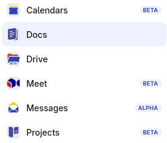

<div align="center">

# office-platform

**Your own office suite (documents, files, calendars, video calls, mail and project boards)
on your own domain, on one VPS or your own Kubernetes cluster.**

Built on [La Suite numérique](https://github.com/suitenumerique), the open-source
collaboration suite built by France's DINUM with European partners, and packaged as a single,
versioned, tested release you install with one command.



</div>

> [!NOTE]
> Much of the code in this repository was written with an LLM. Every change still has to
> pass the [checks](#checks), but read what you deploy and review it before you rely on it
> in production.

## What you get

| | App | What it does |
|---|---|---|
| 📝 | **Docs** | Collaborative documents and notes, edited live together, with full-text search across them (Find) |
| 📁 | **Drive** | Files and folders, shared with people or links, with Office documents opened in Collabora Online |
| 📅 | **Calendars** | Shared calendars and meeting scheduling, plus a CalDAV endpoint for Thunderbird, iOS and Evolution |
| 🎥 | **Meet** | Video calls on LiveKit, with transcripts written into Docs |
| ✉️ | **Messages** | Shared and personal mailboxes with a collaborative inbox (optional, needs port 25) |
| 🗂️ | **Projects** | Boards, lists and cards for project management, with live collaboration |

One login (Keycloak, OIDC) for all of them and one app switcher across them. Each app is a
single switch in your config, so you can run the whole suite or only Docs and Drive.

## Quick start

On a fresh VPS (one machine with a public address, ≥10 cores, fast disk):

```sh
git clone https://github.com/Wqrld/office-platform && cd office-platform
DOMAIN=office.example.org ACME_EMAIL=ops@example.org ./install.sh --k3s
```

Already have a cluster? Use `GATEWAY_IP=10.0.0.5 ./install.sh --existing` and
`./preflight.py cluster.yaml` to check it first. The full walk-through, from nothing to a
serving platform, is [`docs/install.md`](docs/install.md). Create the DNS records before the first
release (see [DNS](#dns)): one wrong record fails the certificate for every app.

---

## How it is built

The platform, whole: the Flux-reconciled configuration, the charts that render it, and
the checks that keep both honest. Released as one git tag that carries the config and
the four charts (`docs/adr/0114`), and installed by an organisation from one file of its own
(`examples/cluster.yaml`). Design and decisions: `docs/adr/`, the original design set in `docs/history/`.

```
charts/
  control-plane/   the chart an organisation installs: renders the Flux control plane —
                   sources, cluster vars, one Kustomization per layer and per ENABLED app —
                   from ~10 typed, schema-checked values (its values.yaml)
  platform-deps/   everything an app needs BEFORE it starts: datastores + secrets
  platform-app/    the surround: HTTPRoutes, NetworkPolicy, PDB
  platform-tenants/ what the platform provisions per app: database, cache users, OIDC secret, grant
examples/          cluster.yaml — the one file an organisation keeps, in a source of its own
cluster/           what the platform installs when the cluster lacks it: Envoy Gateway, MetalLB (adr/0112)
infra/             operators (CNPG, ESO, the Garage operator; cert-manager when asked)
platform/          shared stateful layer — gateway, postgres, valkey, search, keycloak, and
                   the datastores of every app whether enabled or not; objectstore/ is its
                   own layer so `objectStore.mode: external` can leave it out
apps/              one directory per application, each its own Flux Kustomization, with
                   its three sizes in apps/<app>/sizes/ (apps/README.md, Sizing)
policy/            conftest rules — charts/ over what the charts render, config/ over the sources
tests/             every check below, and the cases and goldens they share
```

Reconcile order: `cluster-*` → `infra` → `platform` → `objectstore` → `app-<name>`, with the dependencies
between applications as `dependsOn` edges from the table in
`charts/control-plane/apps.yaml`. Cluster singletons (the Gateway,
PriorityClasses, ClusterIssuers) are plain manifests in `platform/`, not a chart —
`docs/adr/0101`.

Nothing per cluster lives here. A cluster is a `cluster.yaml` in the organisation's own
source, and the `cluster-*` cases in `tests/cases/` are the values files the checks build:
the defaults, the small profile, every app at `large`, a minimal selection on external S3,
and a fresh VPS as `install.sh` writes it.

## Checks

Every job in `.github/workflows/pr.yaml` runs one of these, so the check that fails in CI is
the check you can run here. `tests/cases/index.yaml` is the list of rendered cases every
chart check iterates; a case added there is picked up by all of them.

| Command | Question it answers |
|---|---|
| `./tests/render.py <case>` | what does this case render to? (every chart check renders through it) |
| `./tests/schema.py` | do the schemas — and the control plane's refusals — still reject a bad values file? |
| `./tests/golden.py` | did this template change alter the output? `--update`, then read the diff |
| `./tests/build.py [dir]` | does every layer of every cluster build, with no `${VAR}` left unresolved? |
| `./tests/kubeconform.sh [dir…]` | is what the charts render and what Flux would apply valid for the API server? |
| `./tests/render-diff.sh [base]` | what does this change do to what the clusters actually apply? |
| `./tests/binding.py [app]` | does our surround still attach to what the upstream charts create? |
| `./tests/profiles.py [size]` | do the three sizes still say what they claim to say — every replica count with its budget, every sized release with every size, no release file overriding one? |
| `./tests/check-secrets.py [app]` | do the `postRenderers` envFrom patches still hit exactly the workloads they should? |
| `./tests/startup.py [app]` | will every pod start — can each non-root container run as its image's user, and does every Secret and ConfigMap a release needs come from something it does not wait behind? |
| `conftest verify --policy policy/charts` (and `policy/config`) | do the static rules still fire, both directions? |
| `conftest test --policy policy/charts --parser yaml --all-namespaces tests/golden/` | does the rendered output satisfy them? |
| `conftest test --policy policy/config --parser yaml --all-namespaces apps/ platform/ infra/ cluster/ tests/golden/` | are the pins and remediation settings still as decided? |

`binding.py`, `profiles.py`, `check-secrets.py` and `startup.py` fetch the pinned upstream charts into `.charts/`
(`startup.py` also each image's config, from its registry), so they need network. Everything else is offline. All of them render through `tests/render.py` —
the control plane with `helm template`, each layer with `flux build` — so what a check sees
is what the cluster applies, sizes and the switcher files included. A new app needs a
case in `tests/cases/index.yaml` for each of its platform releases; nothing checks that.

Nothing here needs a cluster. `./preflight.py cluster.yaml` does: it checks a live cluster
has what a `cluster.yaml` assumes. An install from scratch is not yet run by CI.

## DNS

`./dns.py [cluster|cluster.yaml] [--check] [--zone]` prints the records a cluster needs, read
out of the config that will use them: the Gateway certificate's SAN list and every HTTPRoute
hostname, including the ones `platform-app` renders from `routes[].host`. `--check` resolves
each one and reports what disagrees.

Create them all *before* the first release: Let's Encrypt fails the whole certificate if a
single SAN fails validation, so one mispointed record is an outage for every application.

## Runbooks

`docs/install.md` — nothing to a serving platform: `./install.sh --k3s` on a fresh VPS,
`--existing` on a cluster you have.
`docs/releasing.md` — `./release.sh <version>`: one immutable tag for config and charts.

## Licence

[EUPL-1.2](LICENCE). Contributions welcome, see [`CONTRIBUTING.md`](CONTRIBUTING.md).
